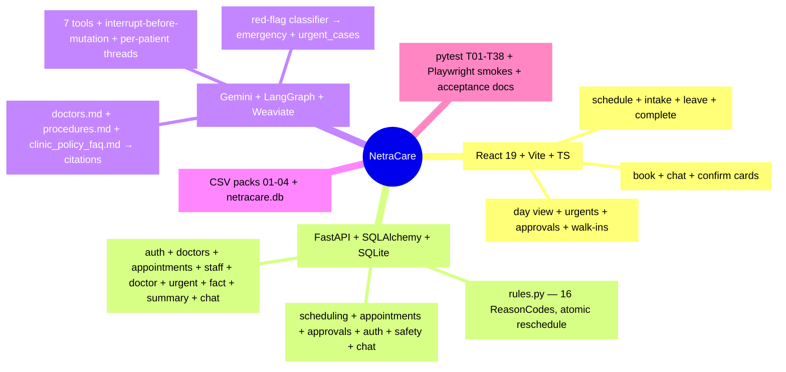
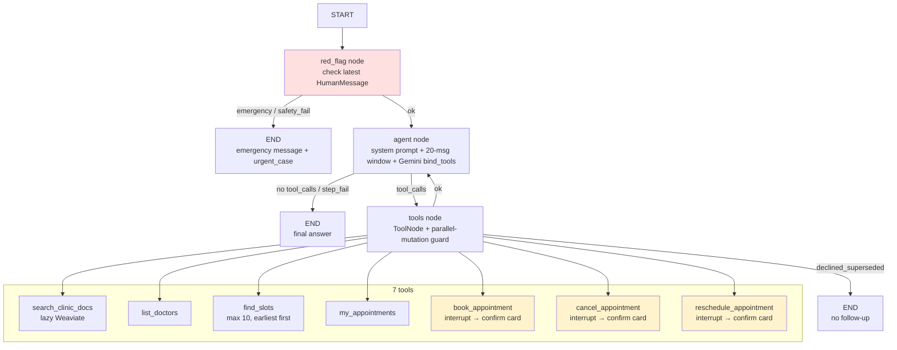

# NetraCare — AI Front Desk for Eye Clinic

> NetraCare answers patient questions, routes each patient to the right specialist, and manages appointments while enforcing every clinic rule and never giving medical advice.

All data is synthetic/fictional. No real patients, no real auth.

## 1. Mindmap — System Architecture & Design



## 2. Booking Agent Graph (Iteration 4)

`backend/app/agent.py` — 3 nodes, `START → red_flag → agent ⇄ tools → END`.



Flow: typed `message` → if pending card exists, decline it first → run graph → `interrupt(payload)` pauses mutation → API returns `{pending_action + summary}` → UI shows Confirm/No → `confirm:true/false` resumes once. Second mutation in same turn is queued, never double-executed.

## 3. High-Level Project Structure

```
NetraCare/
├── requirements.txt          # single reliable Python install (this repo)
├── README.md                 # this file
├── NetraCare_Project_Brief.md# original idea brief
├── backend/
│   ├── app/main.py           # FastAPI wiring (9 routers)
│   ├── app/models.py         # Doctor/Patient/Appointment/Urgent/Approval/Session
│   ├── app/rules.py          # deterministic rule engine
│   ├── app/routers/          # auth/doctors/appointments/staff/doctor/urgent/fact/summary/chat
│   ├── app/services/         # scheduling/appointments/approvals/auth/safety/chat
│   ├── app/llm.py + rag.py   # Gemini + Weaviate answer chain
│   ├── app/agent.py + tools.py# LangGraph agent + 7 tools
│   ├── app/loader.py         # CSV data-pack loader
│   ├── build_index.py        # Weaviate index builder
│   └── tests/                # 38 pytest files (rule suite T01-T38)
├── frontend/
│   ├── src/App.tsx + auth.tsx# role switch + session
│   ├── src/pages/            # Patient/Staff/Doctor workspaces
│   ├── src/components/       # LoginScreen/PatientChat/StaffSearchDebug
│   └── scripts/              # browser/rules/section09/chat smokes
├── Project_Resources/data-pack-Iteration_0*/ # synthetic CSVs + docs
├── docs/                     # iteration-1/3/4-acceptance.md
├── openspec/                 # specs + archived changes 1-4
└── step_by_step_Iterations/  # briefs 1-4
```

Python deps: `requirements.txt` (pinned) == `backend/pyproject.toml` ranges.
Node deps: `frontend/package.json` (`npm install` handles it).

## 4. Run the App (simple, straightforward)

Prereqs: Python 3.11+, Node LTS.

**1) Backend — install once:**
```bash
cd backend
python3 -m venv .venv
source .venv/bin/activate
pip install -r ../requirements.txt
python -m app.loader
```

**2) Backend — start:**
```bash
# from backend/ with .venv active
uvicorn app.main:app --reload
# → http://127.0.0.1:8000 , docs at /docs
```

Classroom login: Patient `{"mobile":"9000001","name":"Asha Verma"}`, Doctor `{"doctor_id":"D1"}`, Staff `{"name":"Front Desk"}`.

**3) Frontend — in a second terminal:**
```bash
cd frontend
npm install
npm run dev
# → Vite proxies /auth /doctors /slots /appointments /staff /doctor /chat to :8000
```

**Optional — AI features:**
```bash
# backend/.env (see backend/.env.example):
GOOGLE_API_KEY=xxx            # Iteration 2 Gemini
WEAVIATE_URL=xxx
WEAVIATE_API_KEY=xxx          # Iteration 3/4 RAG
# then:
python build_index.py         # build NetraCareChunks once (~40 sections)
```

**Deterministic demo (no LLM cost, fixed clock):**
```bash
cd backend
rm -f netracare.db && python -m app.loader
GOOGLE_API_KEY="" GEMINI_API_KEY="" NETRACARE_STUB_SAFETY=1 NETRACARE_CLINIC_NOW=2026-11-27T10:00:00 uvicorn app.main:app
```

**Verify:**
```bash
cd backend && source .venv/bin/activate
python -m pytest
python -m pytest tests/test_rule_suite.py -vv
cd ../frontend && npm run build
# with both servers running:
npm run smoke:browser && npm run smoke:rules && npm run smoke:section09
# live chat only (real keys, no stub):
npm run smoke:chat
```
