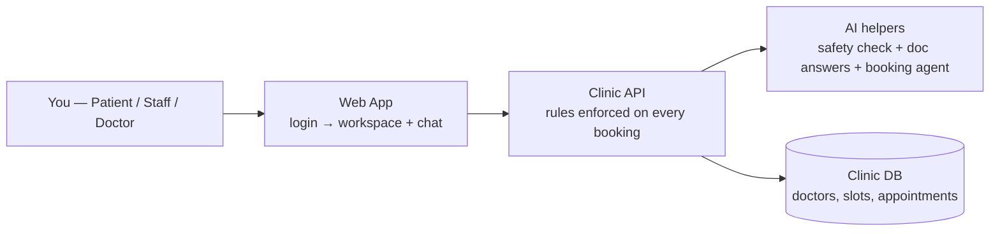
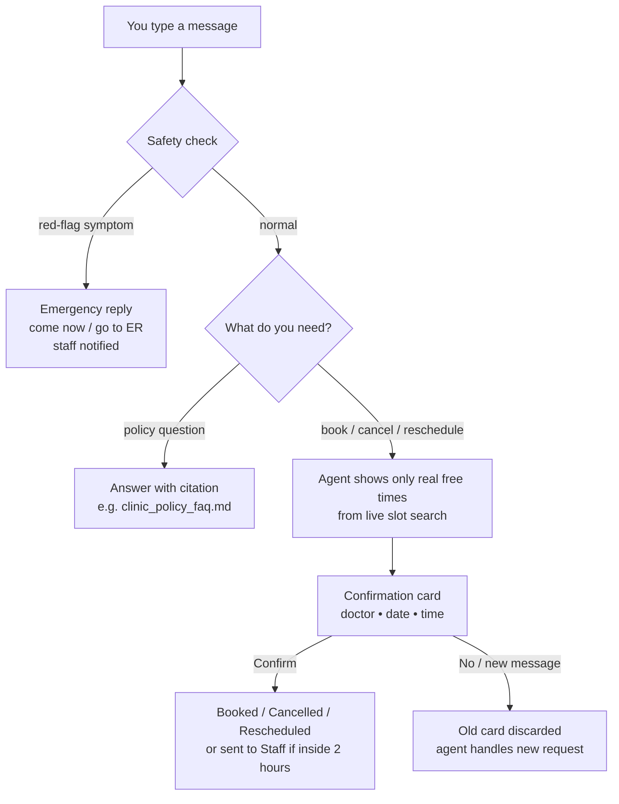

# NetraCare — AI Front Desk for Eye Clinic

> NetraCare cuts front-desk load by answering repeat patient questions, routing each patient to the right specialist, and handling bookings/reschedules/cancels without breaking any clinic rule.

## Abstract

NetraCare is a fictional eye-clinic front desk (all data synthetic, no real patients). Patients wait on hold for the same questions — timings, fees, what to bring — get booked with the wrong specialist, and waste slots by not cancelling. Staff do every booking and change manually. NetraCare fixes this with three role portals (Patient / Staff / Doctor) on top of one rule-enforced API: a deterministic scheduling engine blocks invalid bookings, Gemini safety chains catch red-flag symptoms and create urgent cases, Weaviate RAG answers policy questions with citations, and a LangGraph booking agent searches real free slots and books only after the patient confirms on a card — late changes go to a Staff approval queue instead of breaking the 2-hour rule.

## Architecture — user perspective

Few blocks, what the user actually touches:



- **You** log in with a mobile+name (patient), doctor-id (doctor), or name (staff) — classroom login, not real security.
- **Web App** is the only thing you see: book, chat, confirm cards, approve, leave.
- **Clinic API** says yes/no to every booking using the same rule set — the UI can never bypass it.
- **AI helpers** only add wording: emergency redirect, cited answers, slot search + confirm flow.
- **Clinic DB** is SQLite (`netracare.db`) built from synthetic CSV packs.

## How our booking graph behaves (viewer-friendly)

Forget node names — this is what you experience in chat:



Behaviour guarantees: no time is ever offered unless found free, no booking happens without your Confirm, typing a new message discards the old card, late patient changes never auto-apply — they become a Staff approval and the appointment stays booked.

## High-level project structure — core only

Only files and DBs that run the app (no dev docs, no libraries):

```
NetraCare/
├── requirements.txt
├── backend/
│   ├── app/main.py            # API entry, 9 routers
│   ├── app/models.py          # tables
│   ├── app/rules.py           # booking/cancel rule engine
│   ├── app/routers/           # auth, doctors, appointments, staff, doctor, urgent, fact, summary, chat
│   ├── app/services/          # scheduling, appointments, approvals, auth, safety, chat
│   ├── app/llm.py             # Gemini safety + summaries
│   ├── app/rag.py             # Weaviate cited answers
│   ├── app/agent.py           # booking agent behaviour
│   ├── app/tools.py           # find_slots, book/cancel/reschedule, doc search
│   ├── app/loader.py          # builds DB from CSV packs
│   ├── build_index.py         # builds Weaviate index
│   ├── netracare.db           # SQLite DB (generated)
│   └── .env                   # keys, local only, never committed
├── frontend/
│   ├── src/App.tsx            # role switch
│   ├── src/pages/             # PatientWorkspace, StaffWorkspace, DoctorWorkspace
│   ├── src/components/        # LoginScreen, PatientChat + confirm cards
│   └── src/api.ts             # API client, proxied to :8000
└── Project_Resources/data-pack-Iteration_0*/  # synthetic CSVs + 3 clinic docs (RAG source)
```

## Run the app

Needs: Python 3.11+, Node LTS.

**Setup — once:**
```bash
cd backend
python3 -m venv .venv
source .venv/bin/activate
pip install -r ../requirements.txt
python -m app.loader
cd ../frontend
npm install
```

**Start servers — every time (2 terminals):**
```bash
# terminal 1 — backend
cd backend
source .venv/bin/activate
uvicorn app.main:app --reload
```
```bash
# terminal 2 — frontend
cd frontend
npm run dev
```

Open the app:

- Frontend: http://localhost:5173
- Backend API: http://127.0.0.1:8000 (docs at `/docs`)

Logins: Patient `9000001 / Asha Verma`, Doctor `D1`, Staff `Front Desk`. AI chat needs `GOOGLE_API_KEY` + `WEAVIATE_URL`/`WEAVIATE_API_KEY` in `backend/.env` then `python build_index.py` once — without keys the app still runs, chat answers fall back.

## Optional — Verify

```bash
cd backend && source .venv/bin/activate
python -m pytest
python -m pytest tests/test_rule_suite.py -vv
cd ../frontend && npm run build
npm run smoke:browser && npm run smoke:rules && npm run smoke:section09
npm run smoke:chat   # needs real keys, no stub
```

## Optional — Deterministic demo (fixed clock, no LLM cost)

```bash
cd backend
rm -f netracare.db && python -m app.loader
GOOGLE_API_KEY="" GEMINI_API_KEY="" NETRACARE_STUB_SAFETY=1 NETRACARE_CLINIC_NOW=2026-11-27T10:00:00 uvicorn app.main:app
```
