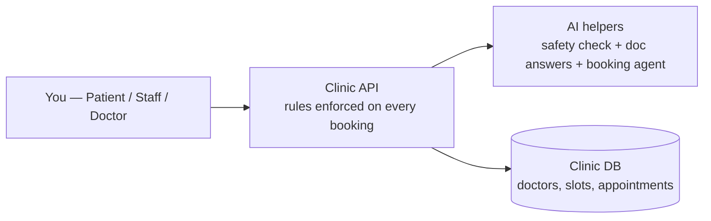

# NetraCare — AI Front Desk for Eye Clinic

> NetraCare cuts front-desk load by answering repeat patient questions, routing each patient to the right specialist, and handling bookings/reschedules/cancels without breaking any clinic rule.

> Status: full-stack — FastAPI backend + React frontend.

## Abstract

NetraCare is a fictional eye-clinic front desk (all data synthetic, no real patients). The backend is the authority for identity, data access, and clinic rules: a deterministic scheduling engine blocks invalid bookings, Gemini safety chains catch red-flag symptoms and create urgent cases, Weaviate RAG answers policy questions with citations, and a LangGraph booking agent searches real free slots and books only after explicit confirmation — late changes go to a Staff approval queue instead of breaking the 2-hour rule.

## Tech Stack

| Layer | Technology |
| ----- | ---------- |
| **Backend** | Python 3.11+, FastAPI, Uvicorn, SQLAlchemy, Pydantic / pydantic-settings, LangChain + LangGraph, `langchain-google-genai` (Gemini safety + summaries) |
| **Frontend** | React 18, TypeScript 5, Vite 5, lucide-react, Vite dev proxy (`/api` → FastAPI) |
| **Database** | SQLite (`netracare.db`, via SQLAlchemy ORM, seeded from synthetic CSV packs) + Weaviate Cloud (vector index for RAG policy answers with citations) |
| **Test / Tooling** | pytest, httpx, python-dotenv |


## Architecture — user perspective

Headless API with AI helpers and SQLite:



- **You** call the API as patient (mobile+name), doctor (doctor-id), or staff (name) — classroom login, not real security.
- **Clinic API** says yes/no to every booking using the same rule set.
- **AI helpers** only add wording: emergency redirect, cited answers, slot search + confirm flow.
- **Clinic DB** is SQLite (`netracare.db`) built from synthetic CSV packs.

## How our booking graph behaves (viewer-friendly)


Behaviour guarantees: no time is ever offered unless found free, no booking happens without Confirm, typing a new message discards the old card, late patient changes never auto-apply — they become a Staff approval and the appointment stays booked.

## High-level project structure — core only

Only files and DBs that run the app (no dev docs, no libraries):

```
NetraCare/
├── requirements.txt
├── backend/
│   ├── app/main.py            # API entry, 9 routers
│   ├── app/models.py          # tables
│   ├── app/rules.py           # booking/cancel rule engine
│   ├── app/routers/           # auth, doctors, appointments, staff, doctor, urgent, fact, summary, chat
│   ├── app/services/          # scheduling, appointments, approvals, auth, safety, chat
│   ├── app/llm.py             # Gemini safety + summaries
│   ├── app/rag.py             # Weaviate cited answers
│   ├── app/agent.py           # booking agent behaviour
│   ├── app/tools.py           # find_slots, book/cancel/reschedule, doc search
│   ├── app/loader.py          # builds DB from CSV packs
│   ├── build_index.py         # builds Weaviate index
│   ├── netracare.db           # SQLite DB (generated)
│   └── .env                   # keys, local only, never committed
└── Project_Resources/data-pack-Iteration_0*/  # synthetic CSVs + 3 clinic docs (RAG source)
├── frontend/                            # React app (`npm run dev` → :5173, `/api` → :8000)
├── dev.sh                               # one-command run: backend + frontend
```

## Run the app

Needs: Python 3.11+, Node 18+.

```bash
./dev.sh
```

First run installs deps, copies `backend/.env.example` → `backend/.env` (if missing), seeds `netracare.db`, and `npm install`s. Every run starts both.

# OR

**Manual run — backend + frontend separately:**

```bash
# terminal 1 — backend
cd backend
python3 -m venv .venv
source .venv/bin/activate
pip install -r ../requirements.txt
[ -f .env ] || cp .env.example .env
python -m app.loader
uvicorn app.main:app --reload
```

```bash
# terminal 2 — frontend
cd frontend
npm install
npm run dev
```

- Frontend: http://localhost:5173. <-- open link
- Backend API: http://127.0.0.1:8000 (docs at `/docs`)

Logins: Patient `9000000001 / Asha Verma`, Doctor `D1`, Staff `Front Desk`. AI chat needs `GOOGLE_API_KEY` + `WEAVIATE_URL`/`WEAVIATE_API_KEY` in `backend/.env` then `python build_index.py` once — without keys the app still runs, chat answers fall back.

## Optional — Verify

```bash
cd backend && source .venv/bin/activate
python -m pytest
python -m pytest tests/test_rule_suite.py -vv
```

## Optional — Deterministic demo (fixed clock, no LLM cost)

```bash
cd backend
rm -f netracare.db && python -m app.loader
GOOGLE_API_KEY="" GEMINI_API_KEY="" NETRACARE_STUB_SAFETY=1 NETRACARE_CLINIC_NOW=2026-11-27T10:00:00 uvicorn app.main:app
```
